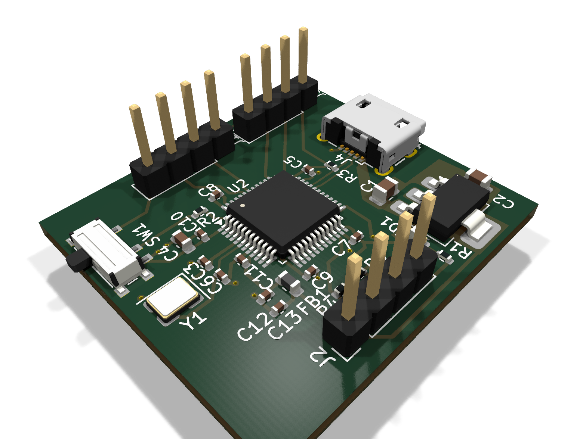
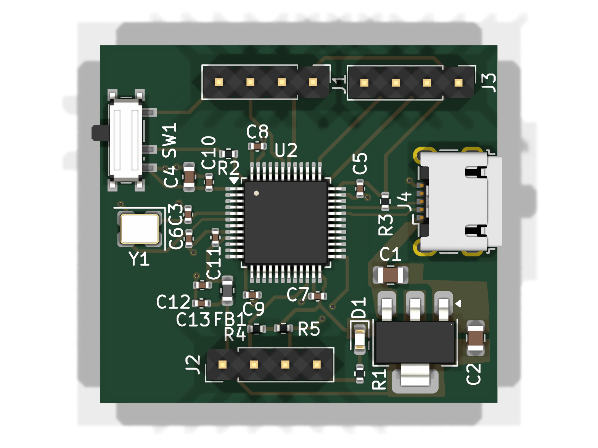
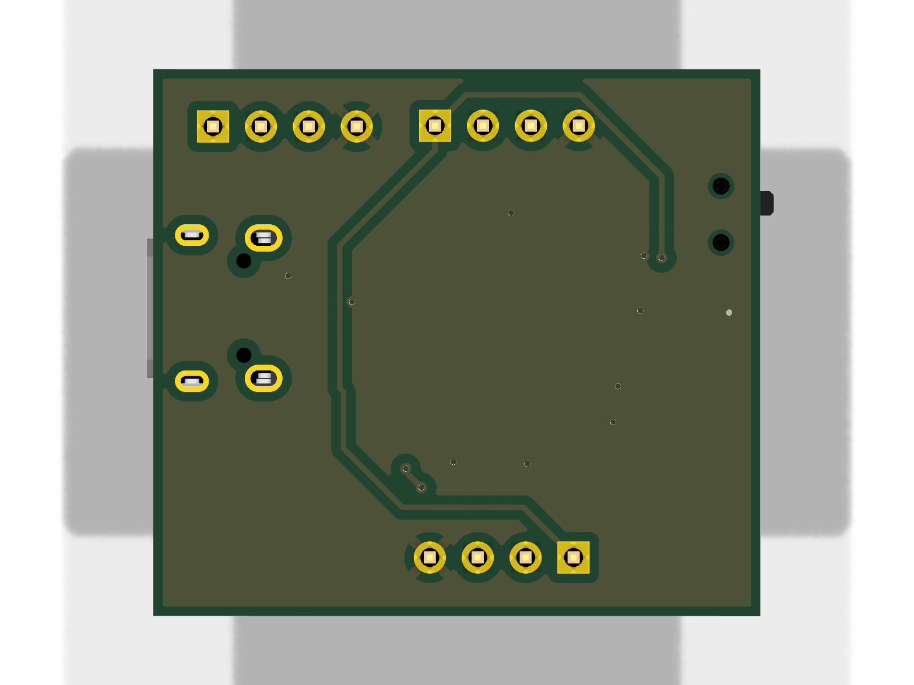

# STM32 Dev Board (KiCad)

A compact 2-layer development board for the **STM32F103C8** (ARM Cortex-M3), designed in **KiCad**. It runs from Micro-USB through an on-board 3.3 V regulator and breaks the MCU pins out to 2.54 mm headers.

  

| Top | Bottom |
|---|---|
|  |  |

## Hardware

| Item | Detail |
|---|---|
| MCU | STM32F103C8Tx, LQFP-48 (U2) |
| Regulator | AMS1117-3.3, SOT-223 (U1) |
| USB | Micro-USB B, Würth 629105150521 (J4) |
| Clock | 3.2 x 2.5 mm SMD crystal (Y1) with 10 pF load capacitors |
| Switch | SPDT slide switch (SW1) |
| Headers | 3x 1x4 2.54 mm pin headers (J1-J3) |
| Other | Ferrite bead for analog supply filtering, power LED, 0402 decoupling capacitors |
| Layers | 2 |
| Tool | KiCad |

## Repository layout

| File | Description |
|---|---|
| `stm32_trial_.kicad_pro` | KiCad project, open this first |
| `stm32_trial_.kicad_sch` | Schematic |
| `stm32_trial_.kicad_pcb` | PCB layout |
| `629105150521 (rev1).stp` | 3D model of the USB connector |
| `docs/images/` | 3D renders |
